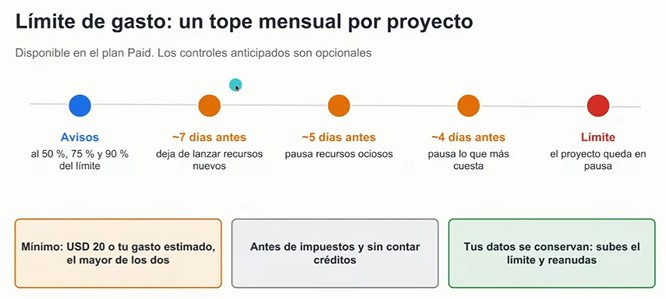
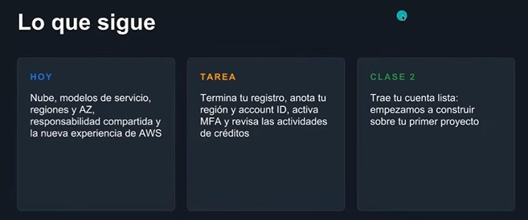

#  QUÉ ES LA NUBE Y QUÉ CAMBIO EN AWS? 
Conceptos base de cloud y la nueva forma de empezar en AWS | Camila Inojosa Anez

requisitos: tener cuenta de AWS
--

Antes para lanzar un app, se necesitaba comprar servidores, esperar semanas, adivinar la capacidad y mantener todo.
Entonces esto soluciona la nube, convierte este tema de infrestructura en algo que se puede solucionar en minutos y pagamos solo por lo que usamos.
#  1. Qué es la nube? 
Es una infraestructura bajo demanda, por interne, con pago por uso.

- Definición de aws: entrega bajo demanda de recursos de TI a través de internet con precios de pago por uso.

Nosotros tenemos nuestra aplicacion y via internet (a traves de la consola o un aAPI) accedemos a recursos en AWS. 
AWS tiene varios servicios como:
- servicios para computo (como EC2, lambda)
- servicios para alamacenamiento (como EC3)
- servicios para Bases de datos (como DynamoDB, RDS)

Entonces los conceptos fundamentalaes para entender que es la nube son 3:
1. Tu accedes a eso que necesitas _Bajo demanda_ -> pides cuando lo necesitas.
2. Por internet
3. Pagas por lo que usas -> puedes pagar y dejar de pagar.

La nube es importante para nosotros como desarrolladores por que:
- Experimentar barato -> podemos implementar poco a poco, prueba error borrar, en la vida real.
- Escalar sin reescribir -> Sirve en cualquier lugar del mundo, por que se puede escalar sin tener que reescribir el codigo completo.
- Enfocarte en tu código

#  2 Modelos de servicio. 
Otro punto importante es saber que modelos de servicio existen y que es lo que administras tú vs. lo que no administras tú.

Si nosotros queremos acceder a un servicio hay cosas que nosotros tenemos que administrar o no, dependiendo del modelo de servicio:

-  **On-Premises**: Imaginemos que tenemos un datacenter del cúal somos dueños y nos encargamos de absolutamente todo, todo al nivel de datos, redes, almacenamiento...
- **IaaS** (Infraestructure as a Service): Es la infrestructura es tu servicio, el servicio al cuál tú accedes, accedemso a la infraestructura a travé del proveedor. El proveedor va a manejar, adminsitrar todo lo que tiene que ver con la red, almacenamiento, servidores y virtualización y todo lo que queda depende de ti (datos, aplicación, runtime...) un ejemplo en AWS es EC2 (un IaaS).
- **PaaS** (Plataform as a Service): La plataforma como un servicio, nosotros solo nos encargamos de manejar los datos y la aplicación y el resto el proveedor.
- **Serverless**
- **SaaS** (Software as a Service): Nosotros solo manejamos los datos.

Dependiendo del servicio de AWS al que nosotros accedamos  vamos a tener que configurar distintas cosas. Estos son como los mundos que existen.

##  ¿Qué administras tú y qué administra el proveedor? 

| Capa | On-premises Tu data center | IaaS Amazon EC2 | PaaS Elastic Beanstalk | Serverless AWS Lambda | SaaS Gmail, Slack |
|---|---|---|---|---|---|
| Datos | Tú | Tú | Tú | Tú | Tú |
| Aplicación | Tú | Tú | Tú | Tú | Proveedor |
| Runtime | Tú | Tú | Proveedor | Proveedor | Proveedor |
| Sistema operativo | Tú | Tú | Proveedor | Proveedor | Proveedor |
| Virtualización | Tú | Proveedor | Proveedor | Proveedor | Proveedor |
| Servidores | Tú | Proveedor | Proveedor | Proveedor | Proveedor |
| Red y almacenamiento | Tú | Proveedor | Proveedor | Proveedor | Proveedor |
| **Pagas por** | Todo, siempre | Hora de máquina | Plataforma encendida | Cada ejecución | Suscripción |

HAY UN SERVICIO PARA CADA MODELO.
(AWS tiene más de 300 servicios)

Iaas --> Amazon EC2 --> Lo usamos cuando necesitamos controlar el sistema operativo o un software especial.

Paas --> AWS Elastic Beanstalk --> Cuando queemos subir una aplicación web y que AWS se encargue de los servidores y balanceo.

Servless --> AWS Lambda + DinamoDB --> Cuando tenemos un código que responde a eventos, queremos almacenarlos y queremos pagar SOLO POR LA EJECUCIÓN.

SaaS --> Gmail, Slack, Notion --> Solo queremos usar un software sin construirlo.

#  Infraestructura global. 
Cómo funciona AWS? - regiones, zonas de disponibilida y edge.

**Una región** es un aubicación geográfica, en esta ubicación geografica nosotros definimos que servicios vamos a utilizar, donde viven estos recursos y donde se almacenaran los datos.

En AWS existen 39 regiones que estan compuestas por almenos 3 zonas de disponibilidad (AZ = Availability Zone).

**Una zona de disponibilidad** es donde encontramos 1 o más data centers.

Por ejemplo tenemos eta imagen:

Representa a una región (Ohio) con 3 AZ, cada AZ estan conectadas entre si. entonces si una de estas falla tiene el respaldo de las otras dos.

tambien estan las **Edge Location** que son como puntos de presencia locales que nos permiten tener meor latencia de los datos a los que queremo acceder.

AWS tiene: 
- 39 regiones
- 124 Zonas de disponibilidad
- 750+ puntos de presencia Cloud Front

Al crear nuestra cuenta de aws veremos en que zona de disponibilidad estara esta cuenta, por que dependiendo de esa zona podre acceder a servicios.

En el caso de latinoamérica tenemos:
- Sao Paulo
- Mexico
- Chile (esta es nueva. hay 3 zonas de disponibilidad)

CÓMO ELIGIMOS UNA REGIÓN?
Tenemos que preguntarnos
- Cuánta latencia pueden soportar mis usuarios? -> dependera de cuanta latencia necesitara nuestra aplicación.
- Leyes de datos del país -> por ejemplo si recolecto datos de las personas de chile, estos datos no pueden salir del país en el que viven.
- Servicios disponibles en esa región que quiero uilizar.
- Precios que varian entre región.

#  RESPONSABILIDAD COMPARTIDA. 
Que portege AWS y que proteges tú.

seguridad EN la nube (lo que tu pones en la nube):
- Si yo construyo una app en la nube/lo que hago **en** la nube
- comunicacion y transferencia de los datos (yo me encargo del cifrado) 
- configuraion de la red (servicio q yo uso)
- TODO lo que tiene ue ver con identidad y servicios (quien accede, descargar, modificar...)
- datos que yo almaceno, no en donde están 

Seguridad DE la nube (nube=aws):
- se encarga de proteger los data centers
- el hardware que tiene en estos data centers
- donde estaran las AZ - red
- Software de servicios que ellos administran

Por ejemplo: tenemos 2 servicios distintos

TODO LO QUE TIENE QUE VER CON DATOS, PERMISOS Y CODIGO DEPENDE DE NOSOTROS.

Cuando usamos ia tenemos que supervisar, si se equivoca nosotros somos responsables.

 SIN REVISAR:
Pides una app al agente -> Crea un bucket público -> Datos expuestos y costos

 REVISANDO:
Lees el plan del agente -> Limite de gasto y acceso privado -> Recursos que entiendes.

#  QUÉ CAMBIO EN AWS? 
(16 de septiembre 2026)

 Antes: 
- Tarjeta obligatoria
- Al crear una cuenta nueva tambien se creaba bajo un usuario raiz (root)
- Miedo a la factura

 Ahora: 
- Login con google o GitHub
- Tiene creditos y limites de gastos

FUENTES OFICIALES PARA PROFUNDIZAR:

- [AWS News Blog: AWS reimagines the getting started experience](https://aws.amazon.com/blogs/aws/aws-reimagines-the-getting-started-experience/)
- [Get started fast with AWS (créditos, plan gratuito y preguntas frecuentes)](https://aws.amazon.com/start-here/)
- [Sign up for AWS (new): guía de registro](https://docs.aws.amazon.com/accounts/latest/reference/sign-in-new.html)
- [Regiones de tus proyectos](https://docs.aws.amazon.com/accounts/latest/reference/project-regions.html)
- [Crear un límite de gasto](https://docs.aws.amazon.com/accounts/latest/reference/create-spend-limit.html)
- [Agent Toolkit for AWS: guía de usuario](https://docs.aws.amazon.com/agent-toolkit/latest/userguide/quick-start.html)
