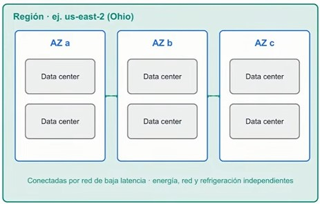
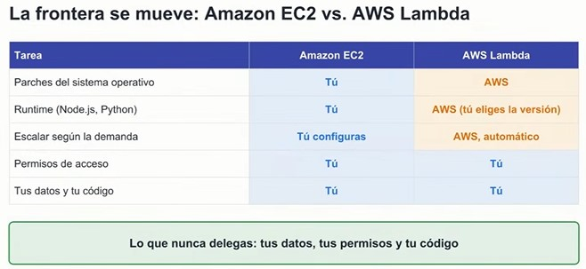
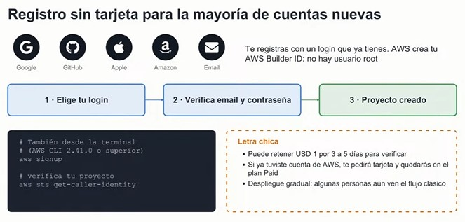
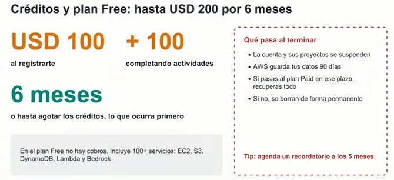

# ¿Qué es la nube y qué cambió en AWS?
**Conceptos base de cloud y la nueva forma de empezar en AWS** | *Camila Inojosa Añez*

* **Requisitos:** Tener cuenta de AWS

---

Antes, para lanzar una app se necesitaba comprar servidores físicos, esperar semanas, adivinar la capacidad y mantener todo. La nube soluciona esto convirtiendo la infraestructura en algo que se despliega en minutos y donde pagamos solo por lo que usamos.

## 1. ¿Qué es la nube?
Es una infraestructura bajo demanda, por internet, con pago por uso.

* **Definición de AWS:** Entrega bajo demanda de recursos de TI a través de internet con precios de pago por uso.

Nosotros tenemos nuestra aplicación y, vía internet (a través de la consola o una API), accedemos a recursos en AWS, tales como:
* **Cómputo:** Amazon EC2, AWS Lambda
* **Almacenamiento:** Amazon S3
* **Bases de datos:** Amazon DynamoDB, Amazon RDS

### Los 3 conceptos fundamentales
1. **Bajo demanda:** Pides los recursos exactamente cuando los necesitas[cite: 13].
2. **Por internet:** Acceso remoto desde cualquier lugar[cite: 13].
3. **Pago por uso:** Puedes encender, pagar y apagar/dejar de pagar cuando quieras[cite: 13].

### ¿Por qué es importante para desarrolladores?
* **Experimentar barato:** Implementar poco a poco (prueba y error, crear y borrar) en entornos reales[cite: 13].
* **Escalar sin reescribir:** Crece globalmente sin tener que rehacer todo el código[cite: 13].
* **Foco en el código:** Menos tiempo administrando fierros y más tiempo desarrollando[cite: 13].

---

## 2. Modelos de servicio
Dependiendo del modelo de servicio al que accedamos, cambian las responsabilidades entre lo que administras tú y lo que administra el proveedor[cite: 13]:

* **On-Premises:** Eres dueño del *data center* físico y te encargas de absolutamente todo (datos, redes, servidores, almacenamiento).
* **IaaS (*Infrastructure as a Service*):** Accedes a la infraestructura del proveedor. AWS maneja red, almacenamiento, servidores y virtualización; tú manejas el sistema operativo, *runtime*, aplicación y datos (ej. **Amazon EC2**).
* **PaaS (*Platform as a Service*):** Te encargas solo de la aplicación y los datos; el proveedor gestiona el resto (ej. **AWS Elastic Beanstalk**).
* **Serverless:** Solo subes tu código que responde a eventos y manejas tus datos, pagando únicamente por cada ejecución (ej. **AWS Lambda + DynamoDB**).
* **SaaS (*Software as a Service*):** Usas un software ya construido y solo gestionas tus datos (ej. **Gmail, Slack, Notion**).

### ¿Qué administras tú y qué administra el proveedor?

| Capa | On-premises Tu data center | IaaS Amazon EC2 | PaaS Elastic Beanstalk | Serverless AWS Lambda | SaaS Gmail, Slack |
| :--- | :---: | :---: | :---: | :---: | :---: |
| **Datos** | Tú | Tú | Tú | Tú | Tú |
| **Aplicación** | Tú | Tú | Tú | Tú | Proveedor |
| **Runtime** | Tú | Tú | Proveedor | Proveedor | Proveedor |
| **Sistema operativo** | Tú | Tú | Proveedor | Proveedor | Proveedor |
| **Virtualización** | Tú | Proveedor | Proveedor | Proveedor | Proveedor |
| **Servidores** | Tú | Proveedor | Proveedor | Proveedor | Proveedor |
| **Red y almacenamiento** | Tú | Proveedor | Proveedor | Proveedor | Proveedor |
| **Pagas por** | Todo, siempre | Hora de máquina | Plataforma encendida | Cada ejecución | Suscripción |[cite: 13]

> **Hay un servicio para cada modelo** (AWS tiene más de 300 servicios)[cite: 13]:
> * **IaaS (`Amazon EC2`):** Cuando necesitas controlar el sistema operativo o instalar software especial[cite: 13].
> * **PaaS (`AWS Elastic Beanstalk`):** Cuando quieres subir una app web y que AWS maneje servidores y balanceo[cite: 13].
> * **Serverless (`AWS Lambda + DynamoDB`):** Código basado en eventos pagando solo por ejecución[cite: 13].
> * **SaaS (`Gmail, Slack, Notion`):** Usar software listo sin construirlo[cite: 13].

---

## 3. Infraestructura global
¿Cómo funciona AWS físicamente? Se divide en **Regiones**, **Zonas de Disponibilidad (AZ)** y **Edge Locations**.
* **Región:** Ubicación geográfica donde viven tus recursos y se almacenan tus datos. AWS cuenta con **39 regiones**, cada una compuesta por al menos 3 Zonas de Disponibilidad.
* **Zona de Disponibilidad (AZ):** Uno o más *data centers* aislados con energía, red y refrigeración independientes, conectados entre sí por redes de baja latencia[cite: 13, 17]. Si una AZ falla, las otras respaldan la operación.
* **Edge Locations (Puntos de presencia):** Ubicaciones locales (más de 750 en CloudFront) que acercan el contenido al usuario final para lograr menor latencia.

**Regiones en Latinoamérica:**
* São Paulo
* México
* Chile (nueva, con 3 zonas de disponibilidad)

### ¿Cómo elegimos una región?
1. **Latencia:** Qué tan rápido necesitan responder los datos a tus usuarios.
2. **Leyes de datos:** Regulaciones locales (ej. datos sensibles que por ley no pueden salir de un país).
3. **Servicios disponibles:** No todos los servicios nuevos están activos en todas las regiones al mismo tiempo.
4. **Costos:** Los precios varían según la región.

---

## 4. Modelo de Responsabilidad Compartida
Define qué protege AWS y qué debes proteger tú:

* **Seguridad DE la nube (Responsabilidad de AWS):**
  * Protección física de los *data centers* y el hardware.
  * Red global, Zonas de Disponibilidad y el software base de los servicios administrados.

* **Seguridad EN la nube (Tu responsabilidad):**
  * Todo lo que construyes y configuras en la nube\.
  * Cifrado en comunicación y transferencia de datos\.
  * Configuración de red de tus servicios.
  * **Identidades y permisos (IAM):** Quién accede, descarga o modifica recursos.
  * Tus datos y tu código.

[cite: 13, 18]

> **Regla de oro:** Todo lo que tiene que ver con **datos, permisos y código** nunca se delega. Si usas agentes de IA para generar infraestructura, debes supervisarlos:
> * **Sin revisar:** Pides una app al agente $\rightarrow$ Crea un *bucket* público $\rightarrow$ Datos expuestos y costos inesperados.
> * **Revisando:** Lees el plan del agente $\rightarrow$ Aplicas límite de gasto y acceso privado $\rightarrow$ Recursos seguros que entiendes.

---

## 5. ¿Qué cambió en AWS? (Septiembre 2026)

*  **Antes:** Tarjeta de crédito obligatoria, creación automática de un usuario raíz (*root*) difícil de asegurar y miedo constante a recibir facturas sorpresa.
*  **Ahora:** Registro sin tarjeta para la mayoría de cuentas nuevas usando **Google, GitHub, Apple, Amazon o Email**. Crea un **AWS Builder ID** (sin usuario *root*) y permite también registro por terminal (`aws signup`).

### Créditos y Plan Free (6 meses)
* Obtienes **USD 100 al registrarte + USD 100 completando actividades** (hasta USD 200 en total) durante **6 meses** o hasta agotar los créditos.
* Incluye más de 100 servicios sin cobros (EC2, S3, DynamoDB, Lambda, Bedrock).
* Al terminar los 6 meses, los proyectos se suspenden y AWS guarda tus datos por **90 días** por si decides pasar al plan *Paid*[cite: 16]. *(Tip: agendar un recordatorio a los 5 meses)*.

### Límite de gasto (Plan Paid)

---

## 📝 Tarea para la Clase 2
* [ ] Terminar el registro de la cuenta de AWS.
* [ ] Anotar tu **Región** y tu **Account ID**.
* [ ] Activar la autenticación multifactor (**MFA**).
* [ ] Revisar las actividades para desbloquear los créditos adicionales.

---

## 🔗 Fuentes oficiales para profundizar
* [AWS News Blog: AWS reimagines the getting started experience](https://aws.amazon.com/blogs/aws/aws-reimagines-the-getting-started-experience/)
* [Get started fast with AWS (créditos, plan gratuito y preguntas frecuentes)](https://aws.amazon.com/start-here/)
* [Sign up for AWS (new): guía de registro](https://docs.aws.amazon.com/accounts/latest/reference/sign-in-new.html)
* [Regiones de tus proyectos](https://docs.aws.amazon.com/accounts/latest/reference/project-regions.html)
* [Crear un límite de gasto](https://docs.aws.amazon.com/accounts/latest/reference/create-spend-limit.html)
* [Agent Toolkit for AWS: guía de usuario](https://docs.aws.amazon.com/agent-toolkit/latest/userguide/quick-start.html)